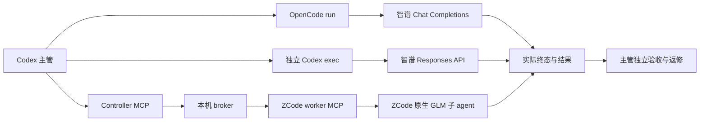

# 调用路径与探索结论

所有“已验证”均指 2026-10-10 本机指定版本的实测，不代表升级后仍适用，也不证明推理质量、性能、净省 token 或权限与主管完全一致。

| 编号 | 路径 | 状态 | 代码／记录 |
| --- | --- | --- | --- |
| A | OpenCode CLI → 智谱 Coding Plan Chat Completions → GLM | 已验证，日常推荐 | [执行器、安装与 probe](../integrations/opencode/README.md) |
| B | 独立 Codex CLI → 智谱 Responses API → GLM | 已验证 | [配置、认证助手、六个 profile、执行器](../integrations/glm/README.md) |
| B0 | 直接请求智谱 Responses API，核验模型和强度参数 | 原六组合 API 已验证；没有 agent 工具执行环境 | [probe-api.py 与说明](../integrations/glm/README.md#独立-api-连通性探针) |
| C | Codex controller MCP → 本机 broker → ZCode worker MCP → 桌面原生 GLM 子 agent | 已验证；当前聊天缓存的旧原生 MCP 入口另有局限 | [安装与协议](../INSTALLATION.md)、[真实验收](../ACCEPTANCE.md) |
| D | 自写 MCP → ZCode 内部 CLI 协议引擎 → 独立 CLI 账户 | 未完成登录／真实模型验收，历史归档 | [实验源码和说明](../experiments/zcode-cli/README.md) |
| E | 用 Computer Use 操作 ZCode 会话、模型选择与 UI 回报 | 曾作为人工界面探索手段；没有发布可复用调度器或端到端自动验收 | 手动兜底，不是本项目默认执行路径 |
| F | GPT 主管原生 spawn_agent 切换 GLM provider，或直接把 GLM 加入 ChatGPT 模型列表 | Codex 0.162.1 原生跨 provider 实测失败；没有修改 ChatGPT 模型列表的实现 | [原生失败记录](../integrations/glm/acceptance.json) |
| G | 在 ZCode “新建 MCP 服务器”页直接暴露 ZCode 模型供主管调用 | 该页面配置 ZCode 使用的 MCP 工具；仅新增配置不构成模型执行服务 | 实际采用 C 的 worker 注册与任务回报，或 A/B 的独立执行器 |
| H | MCP 插件、hooks、定时唤醒／轮询 | 插件作为封装方向讨论；hooks/轮询未启用 | C 已实现事件等待。标准 MCP 不保证唤醒已经结束的主管回合 |

## 选择路径

独立阅读、实现或初步审查优先考虑 A；若需要 Codex CLI 的工具和指定沙箱环境，可选 B；若任务依赖已经载入的 ZCode profile 和桌面会话，可选 C。D 保留版本绑定的协议探索代码，不应被当成后备生产执行器。E 只用于用户明确需要的界面操作。

A、B 会启动独立 GLM 执行进程，不需要桌面路由器常驻；C 需要 worker 模型会话注册并持续接收。MCP 设置页显示连接成功只证明工具可发现，不能替代 `zcode_models` 中的 worker 注册证据。

## 已遇到的问题

- D 的独立 CLI BigModel OAuth 在授权后出现“跳转失败，请返回应用重试”。桌面账户登录不能据此证明 CLI 已认证；此路线没有冒充成功。
- C 曾有旧接收订阅存在但路由器已停止的问题，任务会假在线领取后不执行。0.3 的中断清理、明确重新注册和连接恢复已修复协议行为。真实正常任务通过，但运行中子 agent 的 TaskStop 取消以及部分重注册桌面行为仍未全部复验。
- C 当前聊天曾缓存旧 controller，工具返回 `Relay not connected`。标准 MCP SDK 客户端已连接同一生产服务并完成真实任务；这不等于旧原生工具入口已经恢复。
- B 原生跨 provider 测试返回 GLM 不支持 ChatGPT 账户的错误；独立 GLM Codex 进程可用，原生 GPT spawn 仍不能借这些 profiles 切换 provider。
- A 最初两次文件任务因绝对权限路径匹配失败而未被接受。OpenCode 1.18.31 的 read/edit 按 worktree 相对路径匹配；修正转换后真实文件任务通过，权限范围保持原文件。

## 证据与完整性

[验证索引](verification.md)区分离线协议测试、真实模型请求与主管验收。源码归档只包含本项目写出的适配器和测试，不包含 ZCode 厂商 bundle、浏览器状态、OAuth 状态、账户配置、原始请求或 Key。失败路线保留失败结论，讨论路线保留未实现状态。
